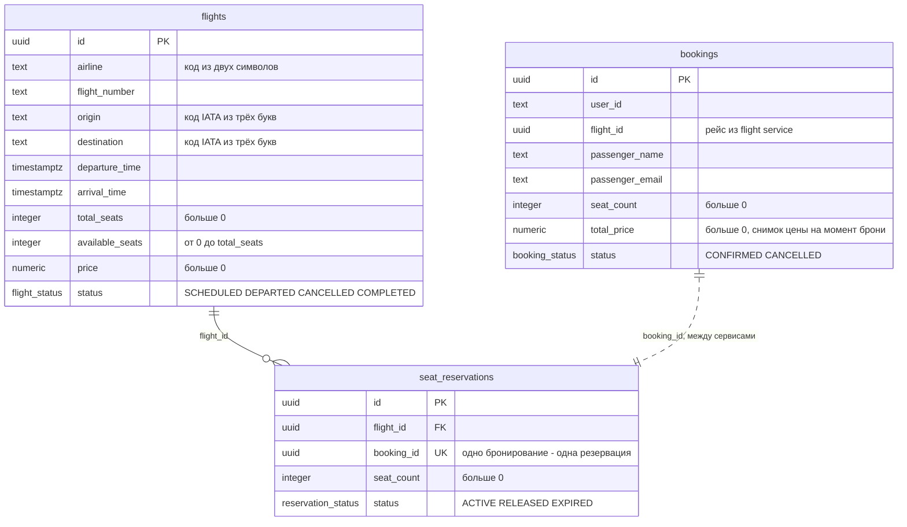

# Flight Booking: gRPC + Redis

два сервиса: booking принимает rest-запросы на бронирования, flight хранит рейсы и места и отвечает по grpc, у каждого своя база postgres, рейсы кешируются в redis с репликой и sentinel

## 1. Запуск и проверка

```bash
docker compose up --build -d
docker compose ps -a
```

пункт 1: flight.proto, четыре метода, Timestamp, enum, коды ошибок, генерация строкой protoc в flight/Dockerfile

пункт 2: диаграмма в разделе 2, ограничения в flight/migrations/V1__flights.sql

пункты 3 и 4, рейсы и бронь:

```bash
curl "localhost:8080/flights?origin=SVO&destination=LED&date=2026-12-10"
curl -X POST localhost:8080/bookings -H "Content-Type: application/json" -d '{"user_id":"u1","flight_id":"11111111-1111-1111-1111-111111111111","passenger_name":"Ivan","passenger_email":"ivan@mail.ru","seat_count":2}'
curl localhost:8080/flights/11111111-1111-1111-1111-111111111111
curl "localhost:8080/bookings?user_id=u1"
curl -X POST localhost:8080/bookings/ID/cancel
```
два рейса, бронь CONFIRMED с total_price 9000.00, у рейса available_seats 148, список с бронью, после отмены CANCELLED и мест снова 150, вместо ID подставить id брони из ответа

пункт 5, нет мест:

```bash
curl -X POST localhost:8080/bookings -H "Content-Type: application/json" -d '{"user_id":"u2","flight_id":"77777777-7777-7777-7777-777777777777","passenger_name":"Ivan","passenger_email":"ivan@mail.ru","seat_count":5}'
curl "localhost:8080/bookings?user_id=u2"
```
409 RESOURCE_EXHAUSTED, список пустой, рейс блокируется select for update в flight/logic.py

пункт 6, ключ: в docker-compose.yml у booking поменять API_KEY на любой другой

```bash
docker compose up -d booking
curl localhost:8080/flights/11111111-1111-1111-1111-111111111111
```
в ответе UNAUTHENTICATED, потом вернуть ключ и повторить первую команду

пункт 7, кеш, запросить рейс два раза:

```bash
curl localhost:8080/flights/11111111-1111-1111-1111-111111111111
docker compose logs flight
docker compose exec redis-master redis-cli TTL flight:11111111-1111-1111-1111-111111111111
```
в логах cache miss, потом cache hit, после брони cache invalidated, ttl не больше 300

пункт 8, retry:

```bash
docker compose stop flight
curl localhost:8080/flights/11111111-1111-1111-1111-111111111111
docker compose logs booking
```
504 через 6 секунд, в логах две строки retry с паузами 100 и 200 ms, повтор ReserveSeats с тем же booking_id возвращает ту же резервацию, это в flight/logic.py

пункт 10, breaker, повторить тот же curl ещё четыре раза:

```bash
curl localhost:8080/flights/11111111-1111-1111-1111-111111111111
docker compose logs booking
docker compose start flight
```
после пятой ошибки 503 сразу, в логах CLOSED -> OPEN, через 15 секунд OPEN -> HALF_OPEN, после запуска flight и ещё одного curl HALF_OPEN -> CLOSED

пункт 9, sentinel:

```bash
docker compose stop redis-master
curl localhost:8080/flights/11111111-1111-1111-1111-111111111111
docker compose logs redis-sentinel
docker compose start redis-master
```
сервис отвечает, в логах sentinel строка +switch-master

таблицы и остановка:

```bash
docker compose exec flight-db psql -U flight -d flight -c "select * from seat_reservations"
docker compose exec booking-db psql -U booking -d booking -c "select * from bookings"
docker compose down -v
```

## 2. Что внутри

девять контейнеров: две базы postgres, два flyway для миграций, три redis: мастер, реплика и sentinel, flight с grpc на порту 50051 и booking с rest на порту 8080

как создаётся бронь: booking зовёт GetFlight за ценой, потом ReserveSeats, flight в одной транзакции блокирует рейс, списывает места и пишет резервацию, booking считает стоимость и пишет бронь со статусом CONFIRMED, если резервация не прошла, брони нет, если не прошла запись брони, резервация снимается через ReleaseReservation

схема в 3nf: все поля зависят только от ключа и друг из друга не выводятся, bookings и seat_reservations связаны только через booking_id, внешнего ключа между базами нет


